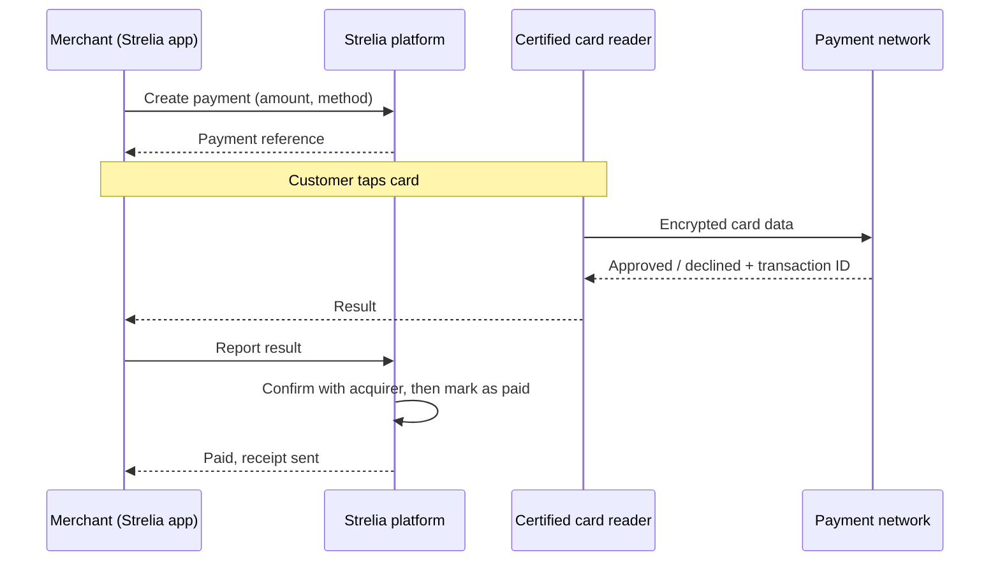

# Strelia

**Turn any smartphone into a payment terminal for merchants in Central Africa.**

Strelia is a SoftPOS and mobile payment acceptance platform built by [Mulu Labs](https://mululabs.io) (Douala, Cameroon) for merchants in the CEMAC zone. A merchant enters an amount on their phone and gets paid by contactless card, by Mobile Money QR code, or by a Mobile Money request sent to the customer's phone. No dedicated payment hardware is needed.

> **Status:** in development, with a working demo. Live Mobile Money and card payments will start once our acquiring bank partnership is finalised.

---

## Why Strelia

Most small and medium merchants in Cameroon and the wider CEMAC region still cannot accept cards. Payment terminals are expensive, hard to get, and often idle. At the same time, almost every merchant already owns a smartphone, and Mobile Money is used every day by their customers.

Strelia gives these merchants one app to accept both:

- **contactless cards** (physical cards, virtual cards and phone wallets) by tap on the merchant's phone, and
- **Mobile Money** from any wallet connected to the regional GIMAC interoperability network.

## Payment methods

| Method | How the customer pays |
| :--- | :--- |
| **Tap to Pay** (card) | Taps a contactless card or phone wallet on the back of the merchant's phone, and enters the PIN on a secure keypad if the card asks for it. Available on Android first, then on iPhone. |
| **Scan to Pay** (Mobile Money) | Scans a dynamic QR code, created for this one payment, with their own Mobile Money app (e.g. MTN MoMo, Orange Money), and confirms with their PIN. |
| **USSD Push** (Mobile Money) | Receives a payment request on their phone from their mobile operator and confirms with their PIN. Works on any phone, without internet. |

All amounts are in **Central African CFA francs (XAF)**.

## How a payment works

1. The merchant enters the amount and chooses how the customer pays.
2. The Strelia platform records a **payment intent** (amount, merchant, method). It is the single source of truth for the final status, and retries never create a double charge.
3. The customer pays with their card, their Mobile Money app or the USSD request.
4. The result is confirmed to Strelia by the payment network or the acquiring bank (signed notification), and the merchant's screen switches to **Paid**. A receipt can be sent by email or SMS.

The merchant never relies on the customer's screen. Only the confirmation received by Strelia counts.

## Security and card data

**Mulu Labs never sees, stores or transmits card data, and never holds customer funds.**

- The card number and PIN are captured by a certified card reader component, certified to the **PCI MPoC** standard, which runs isolated from the Strelia app.
- Card data is encrypted by this certified component and sent directly to the payment network. Strelia only receives the result (approved or declined) and a transaction ID.
- Only verified and activated merchants receive the keys that allow a phone to accept cards. The keys are issued per merchant and kept in the phone's secure storage, never inside the app.
- Each phone is enrolled and must pass device checks: NFC, recent security patch, not rooted, and device integrity check.
- Funds always go from the customer's account to the merchant's own bank account through the acquiring bank. Strelia is not on the money path.
- Payment notifications from the acquirer are signed and protected against replay.

## Merchant onboarding (KYC / KYB)

A merchant can only accept payments after three checks, all done inside the app: the person, the business, and each point of sale. The process follows CEMAC anti-money-laundering requirements (CEMAC/UMAC Regulation No. 01 of 11 April 2016) and COBAC guidance.

1. **Account.** Sign up with email and one-time code.
2. **Identity, once per person.** Name, date of birth, address and tax ID (NIU), and a live scan of the national ID card or passport. The platform reads the document, compares it with the declared data and checks the tax registry.
3. **Business.** Legal form, company name, NIU, activity, address in the CEMAC zone, and the settlement bank account.
4. **Beneficial owners.** Every person holding 25 % or more of the company, with their ID.
5. **Documents.** Trade register extract (RCCM), tax compliance certificate, and for companies the articles of association and director appointment.
6. **Point of sale.** Location map, GPS position taken on site, and expected monthly turnover, which sets the monthly collection limit and the number of allowed phones.
7. **Review.** Automatic activation, review by a compliance officer, or rejection. Companies always go to manual review.
8. **Activation.** The merchant and each point of sale receive their own merchant ID (MID). The merchant then enrols their phones and can invite cashiers and managers, who must also verify their identity.

## Hosting

The Strelia platform is hosted in the European Union, with database redundancy across Africa, Europe and the United States, and content delivery through points of presence in Africa.

## Roadmap

- [x] Merchant onboarding with document scanning and KYC/KYB checks
- [x] Payment intent backend and dynamic QR flow (with a simulated acquirer)
- [x] Tap to Pay on Android in a test environment
- [ ] Production Tap to Pay on Android
- [ ] Acquiring bank partnership and live Mobile Money (GIMAC QR and USSD Push)
- [ ] Tap to Pay on iPhone
- [ ] Local GIMAC card acceptance

## About Mulu Labs

**Mulu Laboratory SARL** (Mulu Labs) is a technology company based in Douala, Cameroon.

- RCCM: CM-DLA-02-2026-B13-00600
- Address: Rue 4.493, Unité 132, Bonabéri, Douala, Cameroon
- Contact: [contact@mululabs.io](mailto:contact@mululabs.io) · +237 654 016 298

---

MTN MoMo, Orange Money and GIMAC are trademarks of their respective owners. Their mention describes the payment methods customers use and does not imply endorsement.
